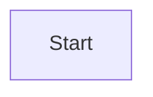

# Explorer Report: nota do tipo Diagrama (Mermaid) com edição visual

> Data: 2026-11-17. Somente análise: nenhum código do app foi alterado e nada foi instalado no projeto.
> Base: branch `feat/mincer` (71aeb72). Task Report: `DOCS/reports/17-11-2026/taskreport_20261117011704.md`.
> Suposições aprovadas: a nota inteira é o diagrama; Mermaid é o formato pedido. Este relatório aponta outro formato onde ele resolve melhor, sem decidir por ele.
> Testes feitos fora do repositório, no scratchpad da sessão (`...\scratchpad\diagram-test`): Mermaid 12.3.0 + Visimer 1.1.4 + React 19.1 com a mesma CSP do Tauri, e React Flow 13 + dagre. Rodaram no navegador embutido do app Claude (Chromium), não no WebView2 do Tauri.

---

## 1. Veredito

**É viável.** A dificuldade depende da opção:

| Opção | Dificuldade | Prazo estimado | Em uma frase |
| --- | --- | --- | --- |
| **(b) Visimer** (lib pronta de edição visual de Mermaid) | **Média** | ~1,5 a 2 semanas para o MVP | Testada: renomear, ligar, criar, apagar e trocar forma funcionam e gravam o código Mermaid. Não move nó livremente |
| (a) Editor próprio sobre um subconjunto (flowchart) | **Alta** | ~3 a 5 semanas | Refaz o que o Visimer já faz (parser que preserva o texto + camada de clique sobre o SVG) |
| (c) React Flow com Mermaid por baixo | **Média-alta** | ~2 a 3 semanas, só flowchart | Único caminho com **posição livre** do nó, mas o desenho do Monet deixa de ser igual ao do Mermaid |
| (c) Excalidraw | Média, mas muda o produto | — | Importa Mermaid e não exporta de volta: a nota deixa de ser Mermaid |
| (c) tldraw | Descartada | — | Licença comercial (chave obrigatória em produção, marca d'água no plano hobby) |

**Obstáculo central confirmado no teste:** o Mermaid calcula o layout sozinho e não tem sintaxe para guardar a posição de um nó. No Visimer, arrastar um nó não o move. Ao criar um nó, o diagrama inteiro se rearranja. Se "mover o nó para onde eu quero" for requisito, só a opção (c) atende, e aí o Mermaid vira formato de troca, não o desenho que o usuário vê.

**Recomendação:** opção (b), com o conteúdo guardado como um bloco ` ```mermaid ` dentro de `notes.content`, um tipo embutido "Diagram" (como o TODOS) e um painel de código como reserva para código inválido. A recomendação vale se o Coordenador aceitar que a arrumação seja por direção e ordem, e não por arrasto (D2).

---

## 2. O problema

O pedido é uma nota em que o conteúdo é um diagrama, criado e alterado na tela (criar nó, ligar, renomear, apagar), sem escrever código. O Mermaid é texto: `A[Login] --> B{Válido?}`. O editor visual precisa ler esse texto, desenhar, receber o gesto do usuário e reescrever o texto sem estragar o que ele não entende.

---

## 3. O que existe hoje no Monet (conferido no código)

| Ponto | Onde | O que importa para o Diagrama |
| --- | --- | --- |
| Nota | `src/types/index.ts:19-39` | Conteúdo é um único `content` em Markdown (`:24`). Tipo e propriedades vão por setters próprios, não pelo `saveNote` (`:29-32`) |
| Tipo de nota | `src/types/index.ts:151-164` | Nome, ícone, cor, `template` em Markdown, `builtin`, `board`. Nenhum campo de comportamento: o comportamento especial do TODOS é decidido pelo id fixo (`src/lib/noteTypes.ts:16-21`) |
| Tipo embutido | `src/storage/tauri.ts:1183-1188` | O TODOS é semeado com `INSERT OR IGNORE` e id fixo. Embutido não é apagado (`tauri.ts:1466`, `:1474`) |
| Quem pode ter tipo | `src/lib/noteTypes.ts:34-40` | Notas de caderno e do Reader. Fora: Calendar e nota-corpo de task |
| Criar nota com tipo | `src/App.tsx:2609-2622` | O template vira o conteúdo da nota nova |
| Trocar o tipo | `src/App.tsx:2669-2702` | Migra propriedades; o template só entra se a nota estiver vazia (`:2697-2701`) |
| "Insert template" | `src/App.tsx:2711-2716` | Acrescenta o template ao fim do conteúdo |
| Editor da nota | `src/App.tsx:3754-3929` (`noteEditor`) | O mesmo `noteEditor` serve a área principal e o modal "Edit note" do board (`App.tsx:4517`). Há outros `Editor` no painel lateral (`App.tsx:3940`), no Reader (`src/components/Reader/ReaderNotesPanel.tsx:308`) e no modal de task (`src/components/TasksView/TaskModalEditor.tsx:138`) |
| Estrutura do `Editor` | `src/components/Editor/Editor.tsx:1064-1203` | Cabeçalho (título, `topSlot`, linha de tags) e corpo Tiptap (`bodyWrap`, `EditorContent`, `BlockGutter`, `HeadingNavigator`) no mesmo componente. O `useEditor` fica em `Editor.tsx:295` |
| Bloco de código no Markdown | `node_modules/tiptap-markdown/src/extensions/nodes/code-block.js:15-19` | Um bloco ` ```mermaid ` faz ida e volta pelo Tiptap mantendo a linguagem. Uma nota-diagrama aberta num editor de texto vira um bloco de código, sem perda |
| Busca Ctrl+P | `src/lib/noteSearch.ts:65-85` | Busca no texto limpo do conteúdo. Bloco de código entra como texto cru |
| Preview e descrição | `src/lib/noteSearch.ts:213-239` | `noteFirstParagraph` pula blocos de código (`:223`): card do board e descrição ficam vazios para um diagrama |
| RAG | `src/lib/noteFileText.ts:285-323` e `:109-189`; uso em `src/hooks/useNotesIndexSync.ts:197` | O Markdown passa quase intacto; o código Mermaid entra no índice como texto |
| Chat | `src/components/NotesChat/notesContext.ts:73`; `src/hooks/useChat.ts:1607`, `:1697`, `:1834` | A IA recebe o código Mermaid da nota |
| Resposta do chat | `src/components/ChatPanel/ChatMessageBubble.tsx:95` + `src/lib/markdown.ts:93-104` | Um ` ```mermaid ` gerado pela IA aparece como código, não como desenho |
| Nota linkada | `src/components/Editor/LinkedNoteBlockView.tsx:32` + `src/lib/markdown.ts:111-122` | Um diagrama linkado dentro de outra nota aparece como código |
| Quem escreve no conteúdo por fora | Merge de notas `App.tsx:3033-3056`; "Save to note" `src/components/ChatPanel/SaveToNoteModal.tsx:200-216`; Assistant `src/lib/assistantNoteBridge.ts:92` | Os três acrescentam texto ao fim da nota. Numa nota-diagrama, isso põe texto fora do bloco Mermaid |
| Export .md | `src/App.tsx:2127-2144` | Grava o conteúdo como está. Um bloco ` ```mermaid ` renderiza no GitHub, no Obsidian e no VS Code |
| Tema | `src/App.css:1-23`, `:89` | O app só tem tema escuro (`color-scheme: dark`), sem tema claro |
| CSP | `src-tauri/tauri.conf.json:44` | `script-src 'self' 'wasm-unsafe-eval'` (sem `unsafe-eval`); `style-src 'unsafe-inline'` permitido |
| Janela keep | `src/components/KeepPanel/KeepPanel.tsx:137-139` | Abre sempre a nota diária do Calendar, que não tem tipo: sem conflito |
| Ícones de tipo | `src/components/NoteTypes/TypeIcon.tsx:303-309` | Conjunto fixo; tem `tree-structure`. `FlowArrow` e `Graph` existem no Phosphor, mas teriam de entrar no conjunto |
| Libs | `package.json:16-60` | Nenhuma lib de diagrama. `@codemirror/*` está no `package.json`, mas sem nenhum import em `src/` |

---

## 4. O obstáculo central: texto com layout automático

**O que o Mermaid faz:** o texto diz quais nós e ligações existem. Quem decide onde cada nó fica é o algoritmo de layout. No Mermaid 12 (atual, 12.3.0), o padrão passou a ser o ELK; antes era o dagre ([release 12.0.0](https://github.com/mermaid-js/mermaid/releases/tag/mermaid%4012.0.0)). Não há sintaxe de coordenada por nó. O pedido de posição manual está aberto desde mar/2024, em triagem, sem resposta de mantenedor ([issue #5420](https://github.com/mermaid-js/mermaid/issues/5420)).

**O que o teste mostrou (Visimer + Mermaid 12):**
- Arrastar um nó com a ferramenta de seleção não o move, e o código não muda.
- Arrastar de um nó a outro com a ferramenta "connect" cria a ligação (`A --> C`).
- Criar um nó rearranjou o diagrama inteiro: o "Login" mudou de lugar.

**O que dá para influenciar sem posição** ([sintaxe ELK](https://mermaid.js.org/intro/syntax-reference.html), [flowchart](https://mermaid.js.org/syntax/flowchart.html)):
- direção (`TD`, `LR`);
- ordem de declaração (`considerModelOrder` no ELK);
- agrupamento em `subgraph`;
- ligação invisível `~~~`, para aproximar nós;
- estratégia de posicionamento do ELK.

São ajustes indiretos, não "pôr aqui".

**Pode-se guardar a posição de um nó arrastado?** No arquivo, sim: um comentário `%% ...` é ignorado pelo Mermaid e o Visimer o preserva (testado). Já uma coluna própria exigiria setter, como o tipo. Mas a posição guardada só tem efeito se o desenho for feito por outro motor (React Flow, opção c). Com o Mermaid desenhando, a posição não é aplicada.

**Implicação:** com a opção (b), o modelo mental do usuário é "estrutura, não lugar". A interface deve oferecer direção, ordem e agrupamento em vez de arrastar.

---

## 5. Opções

### (b) Visimer: recomendada

**O que é:** editor visual de Mermaid da Inkeep, MIT, em pacotes `@visimer/core` (headless, sem DOM), `@visimer/dom`, `@visimer/react`, `@visimer/codemirror` e `@visimer/monaco`. Ele desenha com o próprio Mermaid e põe por cima uma camada de clique. Cada gesto vira uma edição mínima no texto: comentários e linhas desconhecidas ficam como estão ([README](https://github.com/inkeep/visimer), [post](https://open-knowledge-docs.preview.inkeep.com/blog/edit-mermaid-diagrams-visually)).

**Maturidade:**
- 1ª versão em 2026-07-22, 8 versões até a 1.1.4 de 2026-11-16 ([npm](https://www.npmjs.com/package/@visimer/react));
- 152 estrelas;
- uma empresa mantém;
- `react >=18` como peer.

**Testado no scratchpad (React 19.1, StrictMode, CSP do Tauri):**

| Ação | Resultado |
| --- | --- |
| Desenhar flowchart com `theme: 'dark'` sob a CSP do Monet | OK, nenhuma violação de CSP |
| Duplo clique e digitar "Página inicial" | OK: `C[Página inicial]` no código (acentos ok) |
| Ligar nós (ferramenta connect) | OK: `A --> C` |
| Criar nó (`view.addNode`) | OK: `D[Erro]`, já com o editor de rótulo aberto |
| Selecionar e Delete | OK: remove o nó e as ligações dele; no core, também o `click A` |
| Forma, cor, duplicar, editar, apagar | Popover no nó selecionado |
| Desfazer | OK (pilha própria do core) |
| Arrastar para mover | **Não move** (limite do Mermaid) |
| Código inválido digitado | Mantém o último desenho válido e mostra o selo "render error: Parse error on line 3" |
| Comentário e front-matter | Preservados nas edições |

O "Add node", o "Connect" e a direção não têm botão próprio no componente pronto. O app chama `addNode`, `setTool('connect')` e `dispatch` a partir da sua barra, com ícones Phosphor (`Plus`, `FlowArrow`, `ArrowsDownUp`, `Code`, `ArrowCounterClockwise`).

**Riscos:**
- Lib nova, de uma empresa só.
- O badge do repositório diz Mermaid 11, mas o teste com Mermaid 12 funcionou. A ligação entre o SVG e o código depende da estrutura do SVG do Mermaid, então uma atualização do Mermaid pode quebrar a edição. Mitigação: fixar as duas versões e testar ao atualizar.
- O core é MIT e sem dependências: se a camada DOM for abandonada, dá para manter um fork ou fazer a UI própria sobre ele (meio-termo com a opção a).

**O que se perde:** posição livre. Vários tipos só têm edição de item.

### (a) Editor próprio sobre um subconjunto (flowchart)

O trabalho inclui:
- parser e serializador do flowchart que preservem o que não entendem (comentários, `classDef`, `click`, `style`);
- render pelo Mermaid, com a correlação SVG → nó para clique e edição no lugar, ou render próprio;
- ligar por arrasto, apagar, popover de forma;
- desfazer.

O Visimer prova o tamanho: o core sozinho tem 622 KB desempacotado e uma CST "lossless". Também é possível usar `mermaid.parse` só para validar ([API](https://mermaid.js.org/config/usage.html)). O acesso ao grafo interno (`mermaidAPI.getDiagramFromText`) está marcado como interno e obsoleto. **Alta.** Só se justifica se o Coordenador não quiser depender do Visimer. Mesmo assim, o meio-termo "UI própria sobre o `@visimer/core`" reduz o trabalho.

### (c) Alternativas visual-first

| Lib | Licença / React 19 | Mermaid | Posição livre | O que se perde |
| --- | --- | --- | --- | --- |
| **React Flow** (`@xyflow/react` 13.0.1) | MIT; peer `react >=18` (npm). Testado: desenha e arrasta sob a CSP, com `colorMode="dark"` | Nenhum import/export nativo; só projetos comunitários pequenos (`mermaid-reactflow-render`, só render) | **Sim** (testado) | É preciso converter Mermaid ↔ grafo (o `@visimer/core` serve de parser e escritor) e guardar as posições fora da sintaxe (comentário `%%` ou coluna). O GitHub, o export e qualquer outro render do Mermaid ignoram as posições: dois desenhos diferentes. Só flowchart é realista. Formas (losango etc.) são nós custom |
| **Excalidraw** (`@excalidraw/excalidraw` 0.18.1) | MIT; peer `^17 \|\| ^18 \|\| ^19`. Fontes vêm de CDN por padrão; offline exige copiar as fontes e definir `EXCALIDRAW_ASSET_PATH` ([README 0.18.1](https://cdn.jsdelivr.net/npm/@excalidraw/excalidraw@0.18.1/README.md)) | Só importa. `@excalidraw/mermaid-to-excalidraw` 3.6.0 (MIT, motor Pele) converte flowchart, sequence, class, ER, state, gantt, quadrant e timeline em elementos; os outros viram imagem. Não exporta de volta ([npm](https://www.npmjs.com/package/@excalidraw/mermaid-to-excalidraw)) | Sim | O Mermaid: a nota vira cena JSON de quadro branco. Busca, RAG e export precisariam extrair texto da cena. Estilo "à mão". Pacote de 46,8 MB desempacotado |
| **tldraw** 5.6.1 | Licença própria: chave obrigatória em produção (sem ela o editor para em 5 s); hobby mantém marca d'água e é aprovado caso a caso; uso comercial exige licença paga ([license key](https://tldraw.dev/sdk-features/license-key), [licença](https://tldraw.dev/legal/tldraw-license)) | — | Sim | **Descartada pela licença** |
| Outros | O editor visual do Mermaid Chart é parte do produto comercial hospedado ([Wikipedia](https://en.wikipedia.org/wiki/Mermaid_(software))). O Mermalaid (React Flow) é CC BY-NC-SA 4.0 ([repo](https://github.com/bef/mermalaid)) | — | — | Não servem: um é online e pago; o outro tem licença não comercial e "share-alike" |

**Quando (c) resolve melhor:** se o objetivo real for organizar ideias no espaço (quadro, mapa livre), o Mermaid é o formato errado. O React Flow com Mermaid por baixo é o único que dá posição livre e ainda guarda Mermaid. O custo é manter um conversor e aceitar que o Mermaid exportado tenha outro layout.

---

## 6. Tipos de diagrama Mermaid realistas para edição visual

Classificação a partir do README do Visimer e do que foi testado:

| Tipo | Edição visual realista? | Observação |
| --- | --- | --- |
| **Flowchart** | **Sim** (estrutural completa; testado) | Melhor candidato ao MVP |
| Sequence | Sim (estrutural: participantes, mensagens, reordenar arrastando) | Não testado na tela; o core abre sem erro |
| State, Class, ER | Sim (estrutural, segundo o README) | Não testados na tela |
| Mindmap, timeline, kanban, journey, quadrant, gitgraph, C4, architecture, block e outros | Só edição de item (selecionar, editar no lugar, criar, apagar), sem ligar nem reordenar | Mindmap é um caso de "arrastar para reorganizar" que não existe aqui |
| Pie, gantt | Estrutural, segundo o README | Gantt visual sobrepõe Tasks/Calendar: fora do propósito |
| ZenUML | Só leitura | — |

No React Flow (opção c), só o flowchart (e talvez o mindmap) é realista.

---

## 7. Encaixe nos tipos de nota e onde guardar

**Tipo:** embutido, com id fixo (ex.: `diagram`), semeado como o TODOS (`tauri.ts:1183-1188`). O comportamento (corpo de diagrama em vez de Tiptap) depende do id, como o do TODOS depende de `TODOS_TYPE_ID`. Um tipo criado pelo usuário não carrega comportamento, porque `NoteType` não tem campo para isso (`types/index.ts:151-164`). A alternativa é um campo `kind` no tipo, que deixaria o usuário criar vários tipos de diagrama, mas exige coluna nova (D3).

**Template:** o mecanismo atual serve. O template do tipo seria um bloco Markdown inicial, por exemplo:

````

````

Ele entra pelo `createTypedNote` (`App.tsx:2609-2614`). O "Insert template" (`App.tsx:2711-2716`) não faz sentido numa nota-diagrama: esconder, ou trocar por "Reset diagram".

**Conteúdo:** recomendo `notes.content` = um bloco ` ```mermaid ` em Markdown:
- busca, RAG, chat, export, merge e qualquer editor de texto continuam funcionando sem mudança;
- o Tiptap preserva o bloco (`code-block.js:15-19`);
- trocar o tipo para outro não perde nada: vira um bloco de código;
- sem coluna nova e sem o risco do UPSERT do `saveNote` (o estudo de tipos registrou que campo novo precisa de setter próprio).

Uma coluna separada só valeria na opção (c), para as posições.

**Corpo:** o `Editor` junta cabeçalho e corpo (`Editor.tsx:1064-1203`). O caminho é dar ao `Editor` um corpo alternativo (sem montar o Tiptap) ou extrair o cabeçalho para um componente. Isso mantém título, tags e a barra de tipo e propriedades (`topSlot`) no diagrama. Montar o Tiptap escondido junto com o diagrama é arriscado: os dois gravariam o mesmo `content`.

---

## 8. Impacto nos outros caminhos

| Caminho | Com o conteúdo em ` ```mermaid ` | Ajuste sugerido |
| --- | --- | --- |
| Busca Ctrl+P (`noteSearch.ts:65-85`) | Acha pelos rótulos ("login"), mas o trecho mostra sintaxe (`A[Login] --> B{...}`) | Função `mermaidToText` (só os rótulos) no texto de busca do diagrama. **P** |
| Preview, card do board, Open notes (`noteSearch.ts:213-239`) | Vazio (o bloco de código é pulado) | Usar os rótulos como preview. **P** |
| RAG (`noteFileText.ts:285-323`) | Indexa o código Mermaid, que a IA lê bem (quem liga a quem) | Manter o código e acrescentar uma linha `Type: Diagram` (já sai do `typeContext`). Ok como está |
| Chat lendo a nota (`notesContext.ts:73`) | A IA recebe o Mermaid | Ok |
| **IA gerar um diagrama** | O chat mostra ` ```mermaid ` como código (`ChatMessageBubble.tsx:95`) | Botão "Open as diagram" no bloco de código do chat, que cria a nota por clique. Respeita "a IA nunca escreve direto na área permanente" (`DOCS/specs/PRD.md:154`). **M** |
| **IA alterar o diagrama** | Os slash commands são do Tiptap e não existem no corpo de diagrama | Campo "Ask AI to change" na barra do diagrama. A resposta é validada com `mermaid.parse` e mostrada para aceitar ou descartar; aceitar entra no desfazer do editor. **M** (fase 2) |
| Export .md (`App.tsx:2127-2144`) | Funciona: o bloco renderiza no GitHub, Obsidian e VS Code. O layout pode variar de versão para versão do Mermaid | Export SVG/PNG fica para depois (o render já devolve SVG) |
| Merge, "Save to note", Assistant (`App.tsx:3033-3056`; `SaveToNoteModal.tsx:200-216`; `assistantNoteBridge.ts:92`) | Acrescentam texto fora do bloco | Tirar as notas-diagrama da lista de destino, ou avisar. **P** |
| Painel lateral, Reader, nota linkada (`App.tsx:3940`; `ReaderNotesPanel.tsx:308`; `LinkedNoteBlockView.tsx:32`) | Mostram o código; no painel lateral e no Reader dá para editar o código | MVP: aceitar (é seguro). Depois: render só leitura (D9) |
| Tema | O app só tem tema escuro (`App.css:89`). O Mermaid aceita `theme: 'base'` com `themeVariables` ([theming](https://mermaid.js.org/config/theming.html)), que dá para alimentar com `--bg-app`, `--text-primary` e `--accent`. Testado com `theme: 'dark'` sob a CSP | Ver §9, tema |

---

## 9. Edge cases do Task Report

| Caso | Com a opção (b) | Tratamento proposto |
| --- | --- | --- |
| **Usuário arrasta um nó e o layout o devolve** | Pior que "devolver": o nó nem se move, e criar um nó rearranja tudo (testado) | Não oferecer arrasto de posição. Oferecer direção (TD/LR), "mover para antes/depois" (reordena a declaração, que o ELK respeita com `considerModelOrder`) e agrupar em subgraph. Deixar claro na UI: cursor de mover só aparece na ferramenta connect. Se a posição for inegociável: opção (c) |
| **Código inválido ou fora do subconjunto** (colado, da IA, de import) | Se já houve um desenho válido, ele fica na tela com o selo de erro (testado). O core aceita qualquer texto e não lança erro; linhas desconhecidas são preservadas (testado) | Ao abrir uma nota que já nasce inválida, não há desenho anterior: mostrar o erro e abrir o painel de código (textarea ou o CodeMirror já presente no `package.json`, com o binding `@visimer/codemirror`). Tipo só com edição de item: mostrar "edição limitada". Tipo sem suporte: só leitura + código. Código da IA: validar com `mermaid.parse` antes de aceitar |
| **Diagrama grande** | Medido (Chromium, inclui o debounce): 30 nós ≈ 0,28 s; 100 ≈ 0,44 s; 200 ≈ 0,73 s para desenhar. Renomear num diagrama de 200 nós ≈ 0,55 s até redesenhar, porque cada edição redesenha o SVG inteiro. Com 200 nós, o desenho que cabe na tela fica ilegível | Confortável até ~100 nós. Acima disso: zoom (o `panZoom` já existe), aviso de "diagrama grande" e sugestão de dividir em notas linkadas. Medir de novo no WebView2 antes de fechar números |
| **Nota com texto trocada para Diagrama** | Hoje o template só entra em nota vazia (`App.tsx:2697-2701`) | Opções: (i) bloquear a troca com texto; (ii) manter o texto e acrescentar um diagrama vazio no fim, com o texto visível num aviso "esta nota tem texto fora do diagrama" e o botão "View as text"; (iii) a IA propõe um diagrama a partir do texto, com aceite. Decisão D5 |
| **Diagrama trocado para outro tipo** | O conteúdo vira um bloco de código no Tiptap, sem perda (`code-block.js:15-19`) | Nenhum tratamento extra |
| **Template é Markdown** | Serve: o template é um bloco ` ```mermaid ` | O template do tipo Diagram precisa começar com o bloco. Se o usuário o editar para outra coisa, o editor cai no caso "inválido" acima. "Insert template" fica escondido nesse tipo |
| **Tema escuro e cores** | Mermaid 12 mudou o tema padrão para `redux-color`/`neo` ([release](https://github.com/mermaid-js/mermaid/releases/tag/mermaid%4012.0.0)), então o tema tem que ser fixado | `theme: 'base'` + `themeVariables` com `darkMode: true` derivado dos tokens do `App.css`. Riscos: `style`/`classDef` com cor fixa clara (comum em código colado ou gerado) e front-matter `config: theme:` no código, que vence o `initialize`. Opção: ignorar o tema do front-matter ao desenhar no Monet. O export .md não leva o tema do Monet: cada visualizador usa o seu |

---

## 10. Offline, bundle e licenças

**Offline:** Mermaid, Visimer e React Flow são empacotados pelo Vite, sem CDN. O Excalidraw exige copiar as fontes. O tldraw busca assets por padrão e tem a licença.

**Bundle** (medido com Vite 7 no scratchpad; minificado / gzip):

| Item | Minificado | Gzip | Observação |
| --- | --- | --- | --- |
| Mermaid core + Visimer | 809 KB | 202 KB | Chunk inicial |
| ELK | 1.513 KB | 464 KB | Carregado no layout padrão do Mermaid 12 |
| Mermaid inteiro | ~5,3 MB | — | Um chunk por tipo de diagrama, sob demanda |
| React Flow + dagre | 269 KB | 93 KB | — |

No Tauri os arquivos são locais: o custo é o tamanho do pacote MSIX e o parse na primeira abertura de um diagrama. O Monet não usa `React.lazy` hoje, mas já faz `import()` dinâmico (`src/lib/librarian.ts:187`). O Mermaid deve entrar assim, só quando uma nota-diagrama abrir, para não pesar o início do app.

**Licenças** (`npm view`, 2026-11-17):

| Pacote | Licença |
| --- | --- |
| mermaid 12.3.0 | MIT |
| @visimer/* 1.1.4 | MIT |
| @xyflow/react 13.0.1 | MIT |
| @dagrejs/dagre 3.1.3 | MIT |
| @excalidraw/* | MIT |
| tldraw 5.6.1 | "SEE LICENSE IN LICENSE.md" |
| elkjs 0.12.1 | EPL-2.0 OR GPL-3.0-or-later |

O elkjs agora é dependência direta do Mermaid 12. Com ele, convém incluir os avisos de terceiros no pacote distribuído; vale conferir as obrigações da EPL-2.0 para distribuição em binário.

**CSP:** o Mermaid e o Visimer rodaram sob a CSP do `tauri.conf.json:44` sem violação. Nenhum ajuste de CSP foi necessário.

---

## 11. Escopo sugerido para um MVP (se a opção b for escolhida)

| # | Item | Esforço |
| --- | --- | --- |
| 1 | Tipo embutido `diagram` (semeado como o TODOS), ícone `FlowArrow` no conjunto de ícones e template com bloco ` ```mermaid ` | P |
| 2 | Corpo alternativo no `Editor` (sem Tiptap), mantendo título, tags e barra de tipo | M |
| 3 | `DiagramBody`: Visimer + Mermaid por `import()` dinâmico; barra com Add node, Connect, direção, desfazer/refazer, Fit e Code (Phosphor, sem emoji); tema pelos tokens | M |
| 4 | Painel de código como reserva (inválido, tipo sem suporte) | P–M |
| 5 | Helpers `extractMermaid` / `wrapMermaid` e a regra para texto fora do bloco | P |
| 6 | Busca e preview pelos rótulos (`mermaidToText`) | P |
| 7 | Bloquear merge, "Save to note" e Assistant em nota-diagrama; esconder "Insert template" | P |
| Fase 2 | "Open as diagram" no chat; "Ask AI to change" com aceite; render só leitura no painel lateral, no Reader e na nota linkada; export SVG | M |

Total do MVP: ~1,5 a 2 semanas. Não identifiquei necessidade de mudar o escopo do Task Report. O ponto "mover nós" virou a decisão D2.

---

## 12. Decisões que o Coordenador precisa tomar

1. **D1. Abordagem:**
   - (b) Visimer (recomendada; Média);
   - (a) editor próprio (Alta), puro ou sobre o `@visimer/core`;
   - (c) React Flow com Mermaid por baixo (Média-alta);
   - (c) Excalidraw, abandonando o Mermaid como formato.
2. **D2. Posição livre é requisito?** Se arrumar por direção, ordem e grupo bastar, a (b) atende. Se o usuário precisa pôr o nó onde quiser, só a (c) atende, e o Mermaid exportado terá outro layout.
3. **D3. Tipo embutido `diagram` (id fixo, como o TODOS) ou campo `kind` no tipo** (permite vários tipos de diagrama, mas exige coluna nova)?
4. **D4. Formato do conteúdo:**
   - nota = um único bloco ` ```mermaid ` (recomendado), com texto fora do bloco preservado e sinalizado;
   - ou diagrama + área de texto livre na mesma nota?
5. **D5. Nota com texto trocada para Diagrama:**
   - bloquear;
   - acrescentar um diagrama vazio mantendo o texto;
   - ou a IA propõe um diagrama a partir do texto, com aceite?
6. **D6. Tipos de diagrama no MVP:** só flowchart (recomendado), flowchart + sequence, ou todos os que o Visimer edita (com "edição limitada" nos de item)?
7. **D7. IA no MVP:**
   - só leitura (já funciona);
   - + "Open as diagram" no chat;
   - + "Ask AI to change" com aceite?
8. **D8. Código visível:** botão "Code" sempre disponível, ou o código só aparece quando há erro?
9. **D9. Fora da área principal** (painel lateral, Reader, nota linkada): aceitar o código como hoje no MVP, ou render só leitura já no MVP?
10. **D10. Dependências:** aceitar o Visimer (4 meses, 152 estrelas, uma empresa), com Mermaid 12 e Visimer fixados e teste a cada atualização?

---

## Fontes externas

- Mermaid, pedido de posição manual: https://github.com/mermaid-js/mermaid/issues/5420
- Mermaid 12.0.0 (ELK padrão, tema `redux-color`/`neo`, ES2024): https://github.com/mermaid-js/mermaid/releases/tag/mermaid%4012.0.0
- Mermaid, layouts (elk, tidy-tree, cose-bilkent, dagre): https://mermaid.js.org/config/layouts.html (via Context7 `/mermaid-js/mermaid`)
- Mermaid, opções do ELK e ligação invisível: https://mermaid.js.org/intro/syntax-reference.html, https://mermaid.js.org/syntax/flowchart.html
- Mermaid, tema e `themeVariables`: https://mermaid.js.org/config/theming.html
- Mermaid, `parse()` e `mermaidAPI` interno/obsoleto: https://mermaid.js.org/config/usage.html
- Visimer: https://github.com/inkeep/visimer, https://open-knowledge-docs.preview.inkeep.com/blog/edit-mermaid-diagrams-visually, https://www.npmjs.com/package/@visimer/react
- mermaid-to-excalidraw 3.6.0: https://www.npmjs.com/package/@excalidraw/mermaid-to-excalidraw
- Excalidraw, fontes self-hosted: https://cdn.jsdelivr.net/npm/@excalidraw/excalidraw@0.18.1/README.md
- tldraw, licença: https://tldraw.dev/sdk-features/license-key, https://tldraw.dev/legal/tldraw-license
- Mermaid Chart (comercial): https://en.wikipedia.org/wiki/Mermaid_(software)
- Mermalaid (CC BY-NC-SA 4.0): https://github.com/bef/mermalaid
- Versões, licenças e peer dependencies: registro npm (`npm view`, 2026-11-17)
